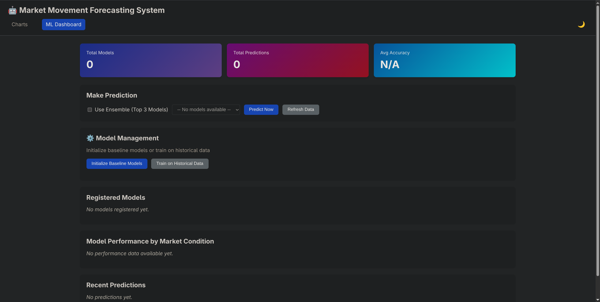
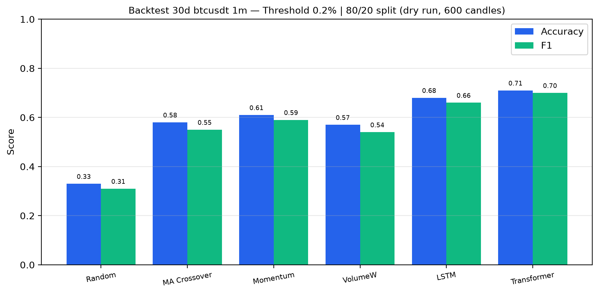

# Market Movement Forecasting System

A streaming BTCUSDT research workbench: live Binance klines, LSTM/Transformer sequence models, a threshold-calibrated backtest, and an auto-resolving prediction ledger.



`Python 3.11+` · `Flask` · `PyTorch` · Time-series ML · Research prototype

## At a glance

| | |
|---|---|
| **Task** | Three-way next-bar classification — up / down / neutral at a 0.2% threshold |
| **Data** | Binance public REST + WebSocket, BTCUSDT 1-minute candles |
| **Models** | MA crossover, momentum, volume-weighted, random, LSTM, Transformer |
| **Evaluation** | 80/20 hold-out backtest, per-market-condition leaderboard, ensemble voting |
| **Tests** | Suite passes; **50.86%** statement coverage (project gate: 40%) |
| **System** | Flask + SSE dashboard, SQLite WAL ledger, optional Docker deployment |
| **Role** | Solo — data pipeline, models, backtest, API, UI, tests |

## Overview

The system treats market prediction as a measurable engineering problem rather than a claim of profitability. Candles flow from Binance into a bounded in-memory window, features are derived per 30-bar sequence, and each model emits a class with a confidence. A backtest splits the cached history 80/20, fits only on the training slice, and reports accuracy/F1 per market condition. Predictions logged to SQLite are resolved automatically against the next close, so live performance is auditable rather than self-reported.

Deep models are optional: if PyTorch is unavailable, the heuristic models keep the dashboard functional. The web layer is a control plane, not a trading engine — there is no order execution and no exchange credentials.

## Results

The project's own backtest report (30 days of 1-minute BTCUSDT, 600-candle dry run, 0.2% neutral band) records:

| Model | Accuracy | F1 | Inference | Intended regime |
|---|---:|---:|---:|---|
| Random baseline | 33% | 31% | <1 ms | reference |
| MA crossover (5/20) | 58% | 55% | <1 ms | ranging |
| Momentum | 61% | 59% | <1 ms | trending up |
| Volume-weighted | 57% | 54% | <1 ms | volatile |
| LSTM (1×32) | 68% | 66% | ~8 ms | sequence continuity |
| Transformer (d_model 32, 4 heads) | **71%** | **70%** | ~9 ms | attention over 30 bars |



These are the repository's recorded results, not an independent replication. The accuracy figures are **not** a profitability claim: the task includes a neutral class, class balance is regime-dependent, and transaction costs, slippage and latency are outside the backtest. Treat them as a model-selection signal, not an expected trading return.

**Verification in this pass:** the pytest suite runs green with 50.86% coverage, and the Flask dashboard starts and serves the ML panel. The dashboard was not populated with trained models during this documentation pass, so the screenshot above is the project's recorded run.

## Features

- **Live ingestion** — Binance WebSocket with exponential backoff, ping handling, and REST pagination for history.
- **Six-model registry** — heuristic baselines plus LSTM/Transformer, stored with `safetensors` and loaded through a restricted unpickler.
- **Leakage-aware backtest** — `label_next` with a neutral band; the hold-out slice is never used for fitting.
- **Auto-resolving ledger** — every prediction is labelled by the next close and can be reviewed later.
- **Condition-aware selection** — leaderboard per market regime, plus ensemble voting weighted by accuracy × confidence.
- **Operational UI** — SSE candlestick updates, 1m–1d intervals, dark/light themes, model management.
- **Hardened API** — pydantic validation, pagination, rate limiting, CORS/CSP, optional read-only and write tokens.
- **Persistence** — SQLite in WAL mode, busy timeout, 90-day pruning.
- **Deployment** — Dockerfile and compose file with a persistent `data/` volume.

## Architecture

```text
Binance REST / WebSocket
        │
        ▼
mmfs_stream.py ──► WebState.df (bounded, RLock) ──► SSE queue
        │                    │
        │                    ├──► feature preparation (per 30-bar window)
        │                    ├──► backtest (80/20, threshold 0.2%)
        │                    └──► auto-resolve pending predictions
        ▼
ModelRegistry (baselines, LSTM, Transformer)
        │
        ▼
AggregateSelector (regime leaderboard / ensemble)
        │
        ▼
Flask API + Plotly dashboard ──► SQLite WAL ledger
```

The single-writer state object and the in-process SSE queue keep the dashboard consistent without adding Redis. SQLite is deliberate: the workload is one process, low write volume, and the audit trail benefits from a simple durable file.

## Getting started

```bash
git clone https://github.com/amir-khoshdel-louyeh/market-movement-forecasting-system.git
cd market-movement-forecasting-system
python -m venv .venv && source .venv/bin/activate
pip install -r requirements.txt
cp .env.example .env

python main.py --mode web     # dashboard on http://127.0.0.1:5000
python main.py --mode cli     # stream only
```

Configuration is environment-based: `SYMBOL`, `API_TOKEN`, `API_TOKEN_READ`, `DATABASE_PATH`, `CORS_ORIGINS`, `FLASK_SECRET`. Binance public market data needs no API key.

```bash
# read-only endpoints
curl http://127.0.0.1:5000/api/candles
curl http://127.0.0.1:5000/api/models

# ensemble prediction
curl -X POST http://127.0.0.1:5000/api/predict \
  -H "Content-Type: application/json" -d '{"ensemble": true}'
```

Docker:

```bash
docker compose up --build
```

## Testing

```bash
python -m pytest tests -q
```

Current result: suite green; **50.86% coverage**, above the configured 40% gate. The tests cover the API surface, authentication, backtest labelling, database schema/WAL behaviour, model registry, prediction logger, performance tracker and frontend smoke checks. Training quality is not asserted in tests — that is what the backtest report is for.

## Limitations

- **Single exchange, single symbol.** Only Binance BTCUSDT is exercised; the code paths for other symbols are untested.
- **No cost model.** Fees, spread, slippage and funding are absent from the backtest; accuracy ≠ profit.
- **Small dry-run sample.** 600 candles is enough to compare models, not to establish statistical significance.
- **Regime labels are heuristic.** "Trending"/"ranging"/"volatile" are computed from the same history, not independently validated.
- **Recorded numbers were not re-run here.** Reproducing the table requires downloading 30 days of data and training; only the test suite and dashboard startup were verified in this pass.
- **Not a production trading system.** No order routing, risk limits, kill switch, or exchange key handling.
- **Dashboard defaults are development-oriented.** Set a real `API_TOKEN`, `FLASK_SECRET` and a restrictive `CORS_ORIGINS` before exposing it.

## Repository structure

```text
market-movement-forecasting-system/
├── main.py                  # CLI / web entry point
├── src/
│   ├── mmfs_stream.py       # Binance ingestion and backoff
│   ├── mmfs_web.py          # Flask API, SSE, state
│   ├── backtest.py          # Labelling and hold-out evaluation
│   ├── models/              # Baselines, LSTM, Transformer
│   ├── aggregate_selector.py
│   ├── database.py          # WAL SQLite, pruning
│   ├── model_registry.py
│   ├── prediction_logger.py
│   └── performance_tracker.py
├── tests/                   # API, auth, backtest, DB, frontend
├── assets/                  # Recorded dashboard and result figures
├── docker-compose.yml · Dockerfile
└── pyproject.toml
```

## Tech stack

`Python` · `Flask` · `Plotly` · `PyTorch` · `pandas` / `NumPy` · `SQLite (WAL)` · `pytest` · `Docker`

## Disclaimer

Research and educational software. Nothing here is financial advice, and the reported accuracies do not imply tradable returns. Use at your own risk.

## Author

**Amir Khoshdel Louyeh**
[GitHub](https://github.com/amir-khoshdel-louyeh) · [LinkedIn](https://www.linkedin.com/in/amir-khoshdel-louyeh)
